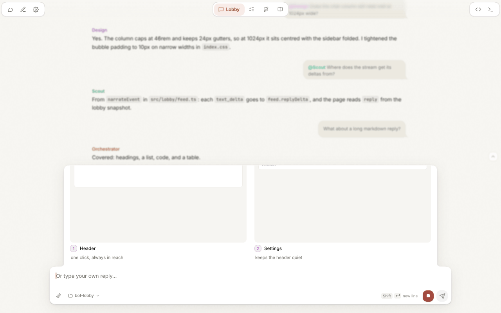
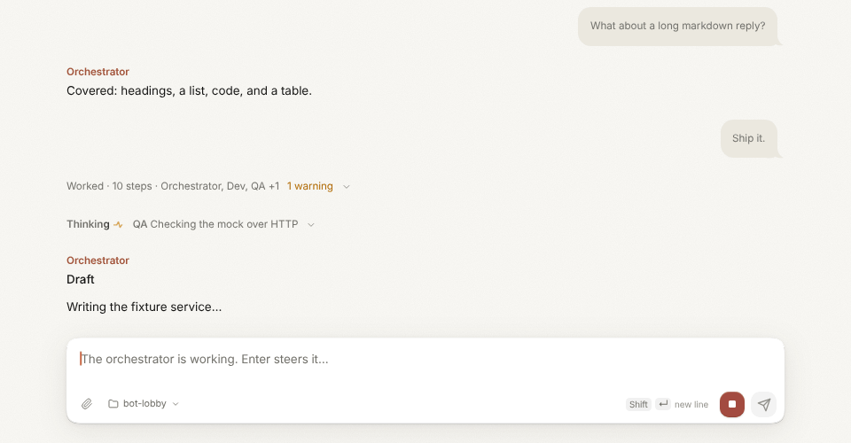
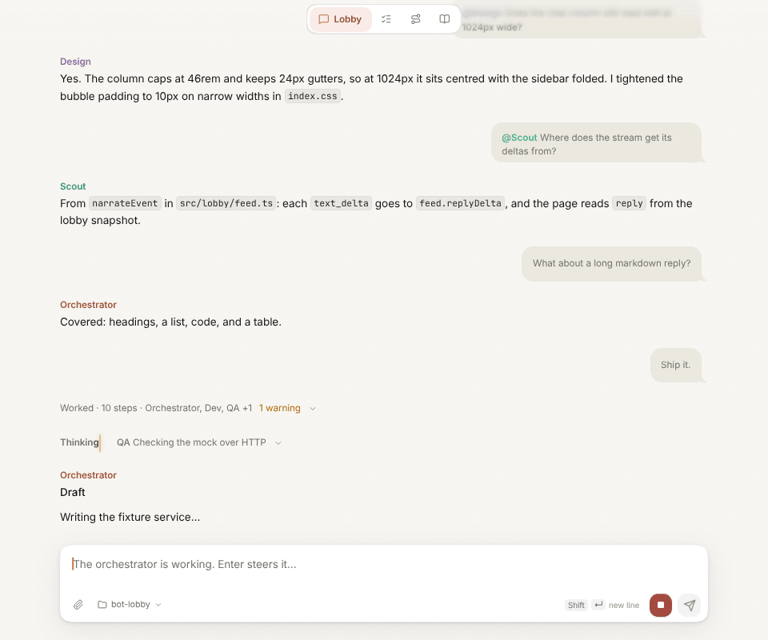
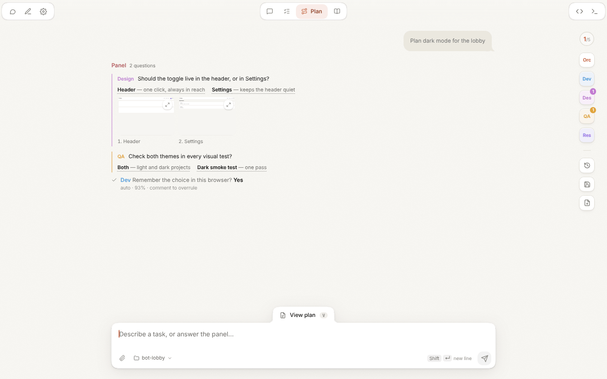
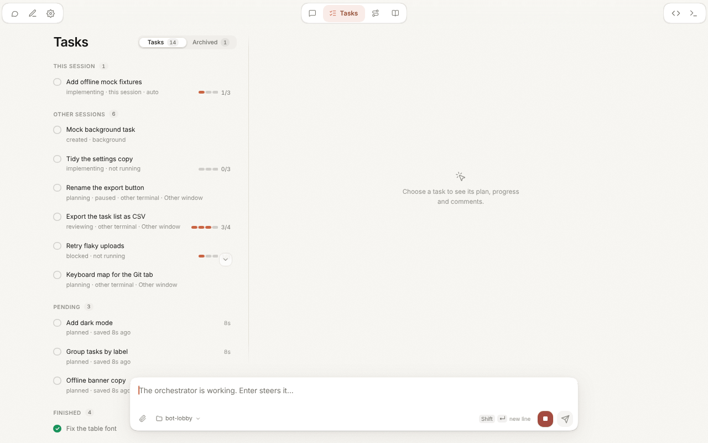
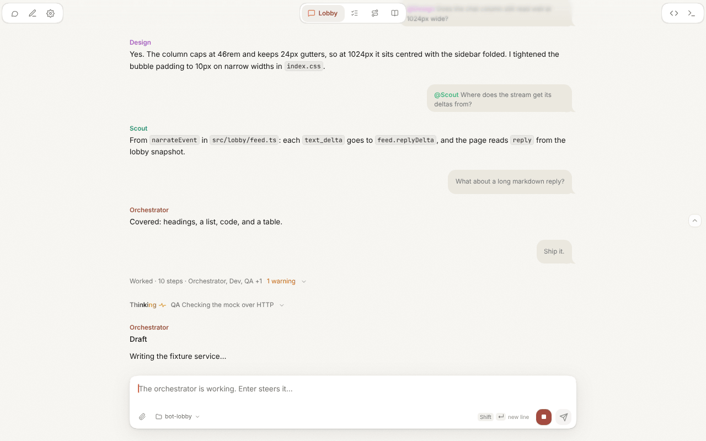
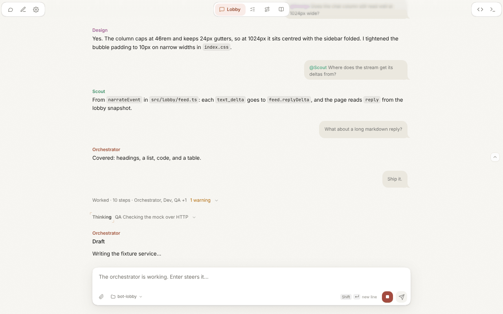
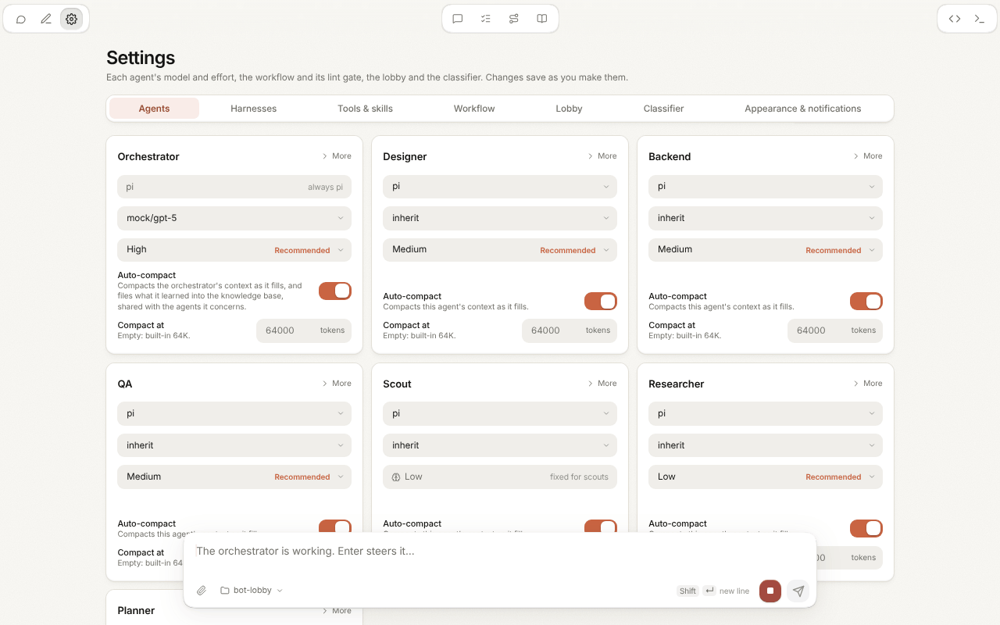

# Bot-Lobby
Bot-lobby is a determenistic agentic coding engine. You can come up with a vague description of what you want to create, the agents (Oracle, Dev, Design, QA and Research) ask you a series of questions to help you form a clear picture from the vague description you've provided. The agents can even generate UI mockups that you can pick from. Once you come to an agreement with the agents, they will then get to work, and the harness will enforce the agreed upon plan. The agents are required to follow it faithfully. 

I came up with the name bot-lobby from my 6+ years worth of HARDCORE experience in playing online FPS games. The name is normally used as a joke or to mock the other players by stating that you're playing in a bot lobby (playing with robots) because of how incompetent they appear to be. The contrary is true for the bots in bot-lobby though, they are quite smart and capable... Well, depending on the models you choose of course.



<sub>Agents ask with real mockups. Expand one, pick it, move on.</sub>

AI written wall of text below: 
## Install

```bash
pi install npm:@a-t-h-i/bot-lobby
```

Try it first with `pi -e npm:@a-t-h-i/bot-lobby`, or from a checkout with `pi -e ./src/index.ts`.
Needs **Pi 1.4.x** (1.4.0 or later). The questionnaire and web tools are built in, so don't also
install extensions with the same tool names.

Then run `/bot-lobby` in Pi to open the lobby. `Ctrl+Shift+M` or `/bot-lobby on|off` turns it on or
off; a new Pi session starts with it off.

## What it does

### Chat with the whole team

Type `/` for commands: `/plan` to plan an idea with the panel, `/task` to hand it straight to the
team, plus Pi commands, your `/skill:name` skills and prompt templates.


Start a message with `@` to choose who answers. Otherwise a classifier hands each message to the
agent whose area it is, and every reply carries its agent's name.



### Watch agents think and work

Each run of agent steps folds into one line in the chat. Open it to see every step, or open
**Thinking** to read what each agent is reasoning about, live.



### Plan in rounds

On **Plan**, a panel of agents asks what it needs to know, round by round. **View plan** (`V`)
opens the draft, and any line takes a comment that goes into the next round.



The rail on the left holds settings, the key list and the theme. The project switcher
(`P`) opens any folder on the machine running bot-lobby. Background sessions still run tasks;
follow their progress and use **Resume** in **Tasks**, without a separate Sessions conversation page.

**Tasks** lists every task across sessions with its steps, timings, approvals and blockers.
**Resume** carries a stopped task on in the background, and a toast tells you it happened.



### Read the changes, run commands

The code viewer shows what the agents changed, as a diff or side by side, and opens any file.



The terminal drawer is a real shell in your project, one click away.



### Tune each agent

Pick each agent's model and effort, run agents on other coding tools (Codex CLI, Claude Code and
more), narrow their MCP tools and skills, and set the workflow and lint gate. Changes save as you
make them.



## The agents

| Agent | Does |
| --- | --- |
| Orchestrator | Your Pi session: questions, plan, delegation and approvals |
| Design | UI, frontend logic, styling and accessibility |
| Dev | Backend, APIs, data, security and integrations |
| QA | The final quality gate, as deep as the change's risk calls for |
| Research | Outside facts, with sources |
| Scout | Reads the code and explains how something works |

`/bot-lobby <request>` in Pi also starts a task. `--fast` / `--full` picks the workflow, and
`--branch` / `--worktree` isolates it in git. Workers never commit: the orchestrator commits only
the files the task changed, after the project's linter and a QA pass sized to the change's risk.

**Knowledge** holds what each agent has learned about your project, which you can edit, annotate
or ask about. The project switcher (`P`) opens any folder on the machine running bot-lobby.

## Keys

Every button shows its key. `Alt+1`…`Alt+9` switch tabs, `j` / `k` move through lists, `/` focuses
search or the message box, `p` switches project, `d` flips the theme and `?` lists every key.

## Configuration

Settings live in `~/.pi/bot-lobby/config.json` (`BOT_LOBBY_CONFIG_DIR` moves them), and
`/bot-lobby config` shows what is in effect. Most are also in the lobby's **Settings**. Tasks and
project knowledge stay in `.pi/bot-lobby/` inside your project.

The [guide](docs/guide.md) covers the rest: delivery and commits, crash recovery, knowledge and
shared scripts, the classifier, delegation, compaction, and MCP tools and skills.
