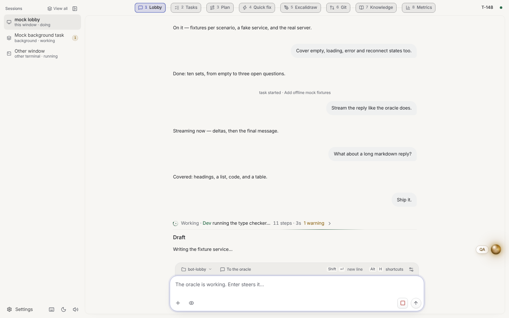
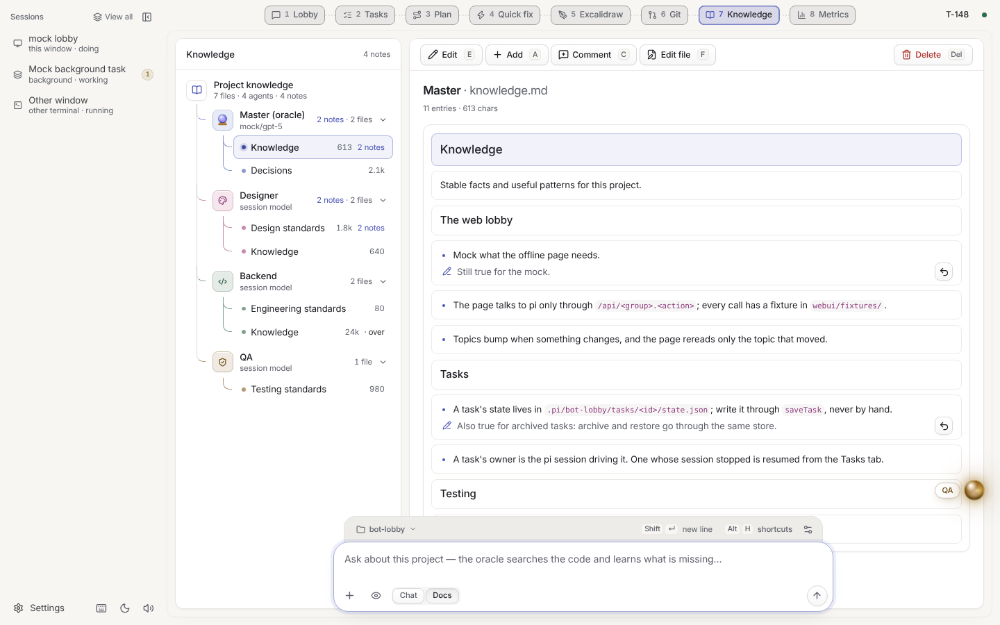
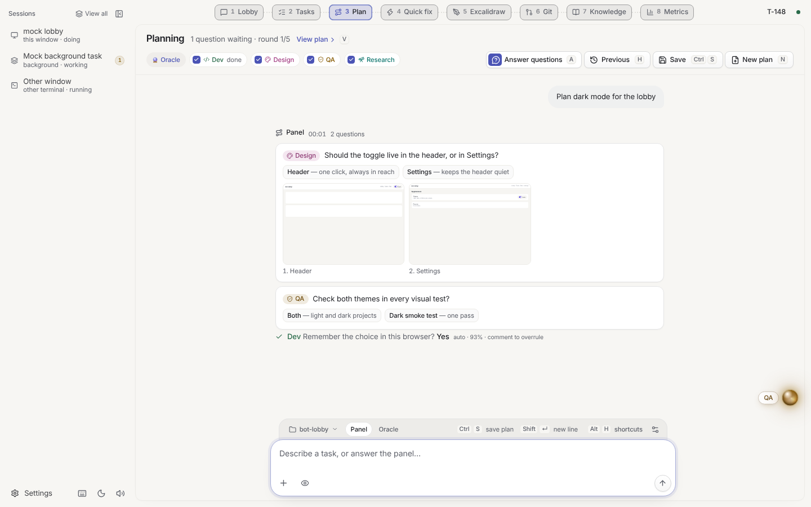
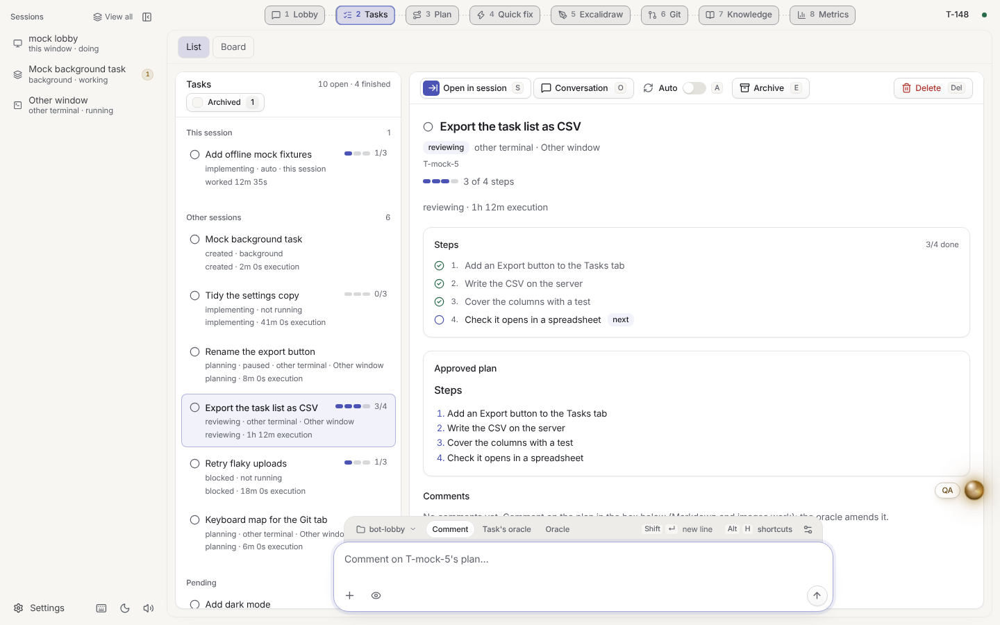
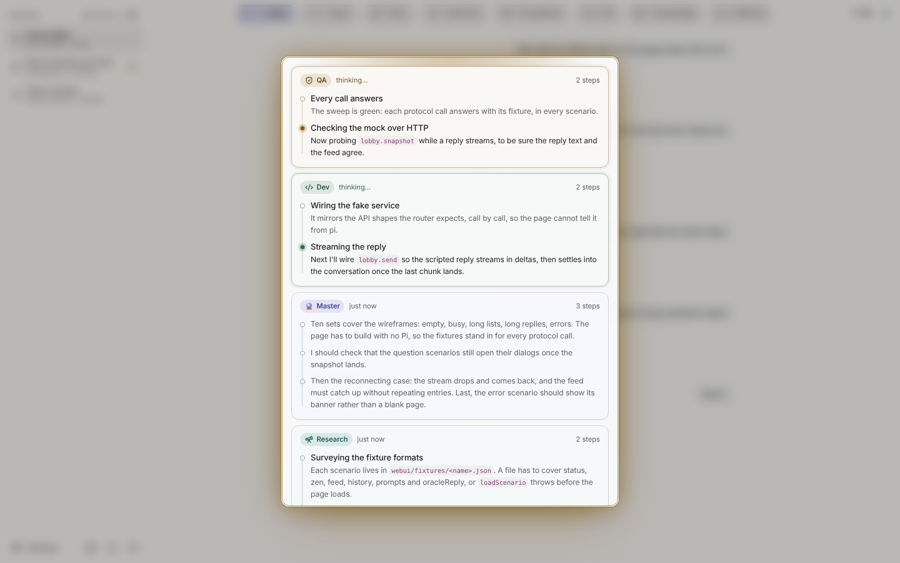
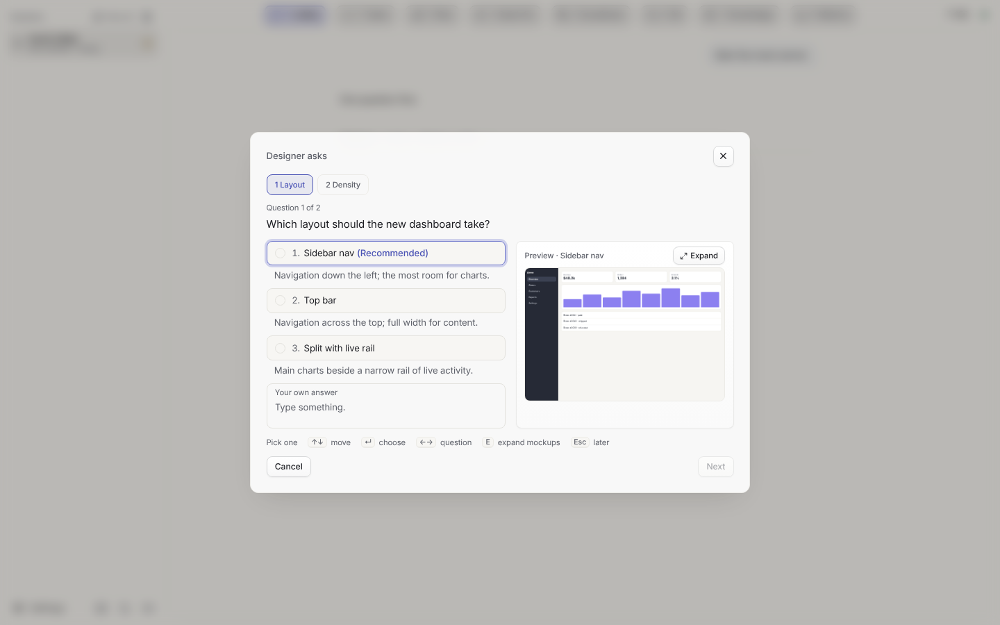
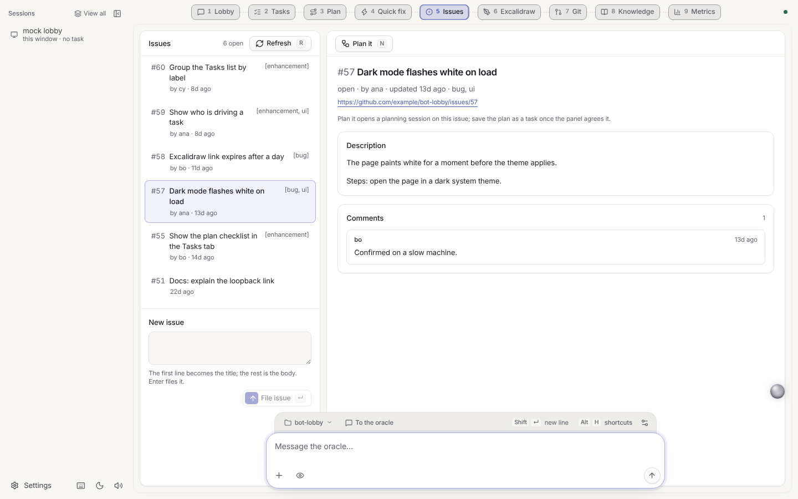
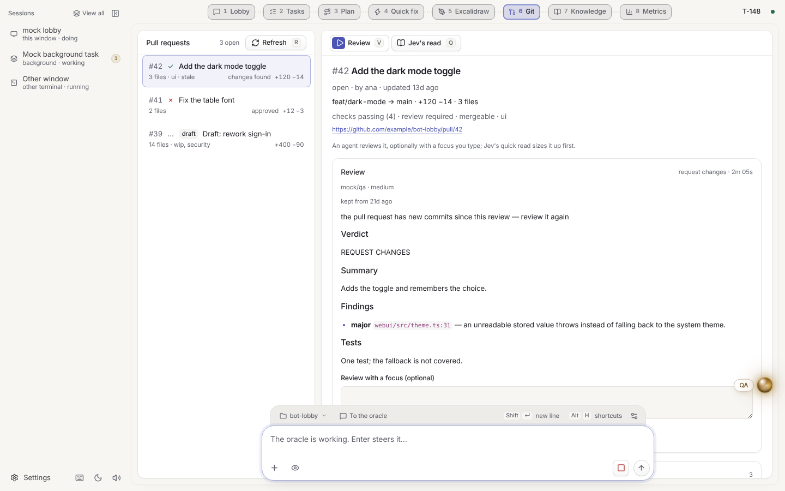

# Bot-Lobby

A [Pi](https://pi.dev) extension for multi-agent software development. Describe a change, agree on a
plan with the oracle, and follow the agents in a local browser lobby. Approvals, domain boundaries and QA
are enforced before anything is called done.



## Install

```bash
pi install npm:@a-t-h-i/bot-lobby
```

Try it first with `pi -e npm:@a-t-h-i/bot-lobby`, or from a checkout with `pi -e ./src/index.ts`.
The questionnaire and web tools are built in, so don't also install extensions with the same tool names.

## Use

1. In Pi, run `/bot-lobby add a login page`. Bot-lobby turns on and the lobby opens in your browser.
   A new Pi session starts with bot-lobby off, as plain Pi: `Ctrl+Shift+M` or `/bot-lobby on|off` switches it.
2. Answer the oracle's questions and approve its plan, or agree on one with the panel in **Plan** first.
   A plan opens with a short list of steps; the detail of each follows for whoever wants it.
   Plans you leave without saving them as a task wait under **Plan → Previous**. You can read, carry on,
   archive or delete them there. A plan saved as a task leaves that list.
3. Follow the agents in **Lobby** and **Tasks**: in a task's steps, the one being worked on reads
   `active · 1m 12s`, and each task shows how long its agents have worked on it (idle time left out). Models, effort and time limits are in **Settings**.

**Issues** lists the repository's open issues (with `lobby.issues` on), and **Plan it** starts a
planning session from one. **Git** lists open pull requests; an agent reviews one on request,
read-only, and nothing is posted to GitHub. Both read GitHub through `gh`.

Small changes go to **Quick fix**. `--task` forces a full task, `--fast` / `--full` picks the workflow,
and `--branch` / `--worktree` isolates it in git. When an isolated task completes, the oracle asks
you to confirm merging and pushing main, then removes its worktree after verifying the merge.
Declining or failed verification keeps the worktree. Delivery can also be reviewed in **Tasks**,
where you can create a PR instead. The task branch is kept.

Workers never commit; the oracle does. When a task completes, the oracle writes a short commit
message (a first line of 72 characters or fewer, at most three lines below it). The engine then
commits only the files that task's workers changed. A quick fix commits its own files when it
finishes, under the one-line message its agent gives. Changes that were already there before, another
agent's and anything no agent made are left uncommitted.

New tasks get a short title summarizing the full request, which also names their branch and
session. Naming uses low reasoning on `classifier.effort.cheapModel` when configured, otherwise
the session model. If naming fails or takes more than eight seconds, the request's first content
words are used. Tasks started from an agreed plan keep that plan's title.

After every worker step, before QA and at completion, the engine runs the project's own linter
(ESLint, Biome, Oxlint, Ruff, or a command you set) on the files the task touched. Only problems on
changed lines count, and QA judges any lint suppression a worker adds. **Settings → Linting** sets it
to off, advise or block. Visual questions come with mockups that expand and scroll side by side.

QA is sized to what was built, not to the request. Once the work is in, the classifier
reads the diff and sets the QA risk. A change with nothing that runs (docs, styles, comments) passes
on the engine's checks with no QA agent, and a small one gets a light check. One that touches
security, data, concurrency or orchestration gets a deep, adversarial review. The test budget is a
ceiling, never a quota, and the Tasks tab shows the classifier's read and why. With it off, the engine's rules decide.

If Pi crashes, is killed or loses its terminal, the lobby page keeps everything on screen and
reconnects when Pi is back. The next Pi started in the project carries on what was running. The
planning session returns as it was, and a round that was cut off runs again. Queued quick fixes
run, and every task's session starts again from its saved file, picking up where it stopped. A
quit on purpose stops this work, and `pi -c` brings back the planning session.

A task that is paused, or that no running session drives, shows **Resume** (`R`) in **Tasks**.
It carries the task on without moving your window: a paused task is unpaused where it runs, and a
stopped one carries on in a background session, which restarts its own session when its file is found.

The **Tasks** screen has **List** and **Board** subtabs. Board groups saved plans and new tasks
in **Backlog**, active work in **In progress**, and finished work in **Completed**. Abandoned
work stays labeled in Backlog until archived. Cards open the existing task details and actions;
archiving removes a card immediately, while the List view can still show the archive.

| Agent | Does |
| --- | --- |
| Oracle | Your Pi session: questions, plan, delegation and approvals |
| DESIGN | UI, frontend logic, styling and accessibility |
| DEV | Backend, APIs, data, security and integrations |
| QA | The final quality gate, at the depth the change's risk calls for |
| RESEARCH | External facts, with sources |

## Projects

Click the project name (or press `P`) to switch between running projects or choose **Open folder…**.
The folder browser lists directories on the machine running bot-lobby, not the browser's machine;
you can browse, go to a parent, or enter an absolute path. An existing project is reused; otherwise
a dedicated Pi session starts for the folder's detected project root. It loads this copy of bot-lobby
without other extensions and does not automatically trust project-local resources. Switching projects
reloads the page and discards unsent drafts. Projects opened this way stop when their hosting lobby
stops; opening a folder does not start a task or merge work.

## Knowledge

Each agent keeps what it learns about your project in `.pi/bot-lobby/<Agent>/knowledge/`:
stable facts (`knowledge.md`), its standards (design language, engineering or testing standards),
decisions with their reasons, and a short history of completed tasks. Workers only propose
knowledge and the oracle records it, so nothing gets in unchecked; research stays evidence until
the oracle keeps it. When a file is long, the classifier picks the parts that matter to each step, so prompts
stay short. A task cannot complete while a file is over `knowledge.compactionThreshold` (20,000
characters): the oracle rewrites it shorter, and the version before is kept under `archive/`.

The **Knowledge** tab shows the files as a tree, from the project to each agent and the model it
runs on. Open a file to edit, add or delete its entries, or leave a note on one ("outdated, we
moved to Redis"). A note travels with its entry into every agent's prompt.



Ask project questions directly from the **Knowledge** composer. The oracle checks saved knowledge
first, searches the codebase for missing information, and records verified findings in the relevant
agent's knowledge. Answers appear in the side pane; the **Chat / Docs** toggle inside the composer
switches back to the selected document. Questions do not create tasks.

## Scripts

Jobs that come back (seeding data, regenerating fixtures, a set of checks before review) are kept
as scripts in `.pi/bot-lobby/scripts/`, shared by every agent, so a step done once is run the next
time instead of being worked out again, which saves tokens and time. Each is named for what it
does, in snake_case with its language's extension (`seed_public_holidays.py`,
`run_changed_tests.sh`), and its first lines say what it is for and how to run it. The oracle
decides when a step is worth a script and saves it (`action=script`); workers only propose one, and
a replaced script is kept under `archive/`. For each step, the classifier picks the scripts that do part of it
and the agent is told to run them (**Settings → Classifier → Shared scripts**; with it off, scripts
whose names share words with the step are suggested).

## Less searching

Agents spend most of their time finding things, so bot-lobby hands them what it already knows:

- **Repository map.** Scouts, workers, quick fixes and the planner get the project's layout and the
  files that match their step, each with what it says it is for and the names it declares. It is
  read from the files themselves, so it needs no model and works with the classifier off
  (`workflow.repoMap`).
- **Scout notes.** What a scout found about a file is kept and shown in the map as long as the file is
  unchanged, so the next task starts from it. A changed file's note is dropped.
- **Reused scouts.** The same question for the same task on a tree with no changes reuses the earlier
  findings instead of running again, for example after a crash and resume (`workflow.reuseScouts`).
- **Line anchors.** Scouts report `path:12-40`, and the oracle copies those anchors into each brief,
  so a worker opens the exact place.
- **Tool budget.** A scout is told to wrap up after 60% of `scout.maxToolCalls` (30). Past the limit,
  further calls are refused, so it reports with what it has (0 means no limit).

## Classifier

A fast classifier makes the small decisions so the large models don't spend tokens on them: who
sits on the planning panel, a task's size, how hard each step is, which files, knowledge and
scripts it needs, and how much QA a change warrants. It is off until you turn it on in
**Settings → Classifier**, and every decision falls back to plain rules when it is off or fails.

**Answered by** picks who answers, from the models your pi logins offer:

- **Jev on a host** (the default): TypeSafe's classifier on OpenCode Zen (free while it lasts),
  TypeSafe, OpenRouter or the Vercel AI Gateway.
- **Another classifier model** pi lists for your logins, such as Cloudflare's clef, Liquid's d1,
  Upstage's solar-decide or Inception's mercury-decide. These answer the same typed questions natively.
- **Any chat model you are signed in to** (an OpenAI, Anthropic or Google account, an API key,
  OpenRouter, …). It answers the same questions as JSON with the least reasoning the model allows.
  It is slower and less calibrated than a classifier model, so pick a small, fast one.

The thresholds in `config.json` are tuned for Jev; raise them if another model decides too eagerly.

## Keys

The lobby is keyboard-first, and every action button shows its key (`Archive E`, `Delete Del`).
`Alt+1`…`Alt+9` switch tabs, `j` / `k` move through lists, `/` focuses search or the message box,
`p` switches project, `d` flips the theme and `?` lists every key. Alt and Ctrl shortcuts can be
rebound with `lobby.keys`. In Pi, `Alt+G` toggles auto mode and `Ctrl+Shift+M` turns bot-lobby on or off.

## Screenshots

| Planning | Tasks |
| --- | --- |
|  |  |
| **Thinking** | **Questionnaire** |
|  |  |
| **Issues** | **Git** |
|  |  |

## Configuration

Settings live in `~/.pi/bot-lobby/config.json` (`BOT_LOBBY_CONFIG_DIR` moves them), and
`/bot-lobby config` shows what is in effect. Colour themes you import, under a name you choose,
are kept in `themes.json` beside it, so every Pi session and project shows them. Tasks and
project knowledge stay in `.pi/bot-lobby/` inside your project.


Requires **Pi 1.0.x** (1.0.1 or later). DEV and DESIGN workers and QA reviewers can use
`delegate_subtasks` for useful, separable work. Delegation is optional. Each parent gets five child
slots total, shared across retries; the classifier selects each child’s model and reasoning effort from its brief, lowering
inference for simple work and raising reasoning for complex work on the configured
model. Children inherit the parent’s role,
permissions, worktree and remaining time. Children report to their parent, which
integrates and verifies the result. Children cannot delegate further. Active
children share `workflow.maxParallelWorkers`; waiting parents do not use those
child slots. Cancelling or finishing a parent stops its children and releases
their file claims. Full reports are saved under `.pi/bot-lobby/delegations/`.

Every assignment has a 15-minute total allowance (or its shorter configured limit),
including startup, tools, retries, children, compaction and reporting. Per-step
allowances persist across reassignments; only the user can extend them, including
in auto mode. Waiting for user answers pauses clocks.

In **Tasks**, a step being worked on shows how many agents are on it, for example
**Implement large feature (6 agents working)**. Click the count to see which agent is
doing what, with children under their parent. Queued and finished agents are left out,
and a child finishing does not complete a checklist step.

The oracle, agents and children compact at settled turn boundaries before context
reaches 64,000 estimated tokens, or earlier at 60% of the model window or Pi's
native reserve threshold. Recent messages and summaries retain unfinished work;
raw session history remains available. A failed summary leaves context intact.
Checkpoints preserve constraints, decisions, changed files, verification, failed
approaches, and next actions. A single large input can exceed the threshold before
the next settled boundary.

Pi's native MCP, `tool_search` and `codemode` are available. **MCP tools** in each
agent's Settings entry grants exact tool names, one per line, such as
`mcp__github__get_issue`. In `config.json` the same field is `mcpTools: ["mcp__github__get_issue"]`
on `master`, `agents.backend`, `agents.designer`, `agents.qa`, `scout`, `researcher`,
`quickFix` and `planner`. Grants default to empty and children inherit them.
Read-only roles also require the server's `readOnlyHint: true`; hidden tools and
ungranted calls are blocked, including calls nested inside codemode. Configure
server connections through Pi's native MCP settings.
